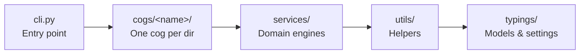

# Contributing

Thanks for improving this project. This guide covers the local setup, workflow, and conventions expected for pull requests.

## Local Setup

Prerequisites:

- Python 3.12 or newer
- [uv](https://docs.astral.sh/uv/)
- `ffmpeg` for video download and merge features

Set up the repository:

```bash
git clone https://github.com/Mai0313/discordbot.git
cd discordbot
uv sync --all-groups
cp .env.example .env
```

Fill in `.env` following the comments in `.env.example`.

Run the bot:

```bash
uv run discordbot
```

The `scripts/*_dev.py` smoke tests call the live APIs using the credentials in `.env`, so every run is a paid call; edit the call under `if __name__ == "__main__":` and run `uv run python -m scripts.<name>`. `make gen-docs` regenerates `docs/` and the `mkdocs.yml` nav from the README files, `CONTRIBUTING.md`, and the Python sources.

## Architecture

Imports under `src/discordbot/` flow left to right only (`tests/guards/test_package_layering.py`):



Any layer may import from the layers to its right, never to its left; `services/` is Discord-free, and a cog directory never imports from a peer cog's directory: use the bot instance, `typings/`, `utils/`, or promote the shared part into `services/`.

## Workflow

- Create a focused branch such as `feat/your-change`, `fix/your-bug`, `docs/your-doc-change`, or `chore/your-maintenance-task`.
- Keep PRs scoped. Avoid unrelated refactors.
- Use Conventional Commits for commit messages and PR titles:

```text
feat: add blackjack surrender option
fix(economy): prevent duplicate settlement
docs: simplify user README
```

- Add or update tests for behavior changes.
- Update user-facing docs when commands, configuration, or visible behavior changes.
- For slash-command behavior, update `src/discordbot/cogs/gen_reply/capabilities.md` and the command table of all three READMEs in the same change, and keep `tests/guards/test_capabilities.py` passing. That English document is injected into the reply so the bot can answer "what can you do" in the asker's language; the guard covers group subcommands, so each `/<group> <subcommand>` needs its own line there.
- Run the local checks in [Tests And Quality Gates](#tests-and-quality-gates) before opening the PR.

## Code Conventions

- Follow existing project patterns before adding a new abstraction.
- Pick a log level with the ladder in [Logging](#logging) below.
- Keep cog `setup(bot)` functions synchronous:

```python
# src/discordbot/cogs/<name>/cog.py
def setup(bot: commands.Bot) -> None:
    bot.add_cog(MyCog(bot), override=True)
```

`async def setup` is not safe here: cogs load inside `DiscordBot()` before any event loop runs, so nextcord's attempt to schedule it raises and boot aborts with `ExtensionFailed`.

- Slash commands take their English `name` and `description` as the defaults, plus `name_localizations` and `description_localizations` for `Locale.zh_TW` and `Locale.ja`.
- Use Pydantic for structured data models. Prefer `BaseModel`, frozen models, enums, and typed result objects over dictionaries or `dataclass`.
- Environment-backed settings should use `pydantic_settings.BaseSettings` with explicit `validation_alias=AliasChoices("ENV_NAME")`. A new one goes into `.env.example` in the same change: it is the only settings list a deployer sees.
- Keep `Field(description=..., examples=...)` populated for configurable values. These descriptions document the environment contract.
- Prefer precise typed APIs. `Any` is a last resort.
- Keyword arguments are required for normal function calls, including single argument calls such as `create_engine(url=...)` and `re.compile(pattern=...)`.
- No bare `*` in a function signature unless an external API needs it; `tests/guards/test_no_bare_star.py` enforces this and lists each exception with its reason.
- Accept normal positional-only idioms such as `len(value)`, `str(value)`, `Path("file")`, `text.split(",")`, exception constructors, variadic collectors, and `logfire.info("message")`.
- Whichever of `service_tier`, `extra_headers` and `extra_body` a `responses.create` / `.parse` or `interactions.create` call passes goes as an explicit keyword, never through a `**dict` spread, which costs the result its types.
- Build the `tasks` list for a `gather` over a variable number of awaitables with a `for` loop, not a comprehension.
- Avoid intermediate one-level aliases when directly using the original object is clearer.
- Prefer a constant with one caller inside that function, unless anything else references it, it is user-visible config, or it belongs in `typings/timeouts.py` or `typings/context_budgets.py`.
- No compatibility wrappers, re-exports at an old import path, migration code, or read-path tolerance for an old data layout: repoint every caller, and clean changed data once, offline.
- Do not blanket `# noqa`. Use the narrowest rule-specific ignore with a short reason.

## Comments

A comment earns its place only when deleting it would let the next reader break the code. Write the trap, the invariant, or the constraint that is not visible from the code. Everything else is what `git log`, the pull request and the issue are for.

**One fact, one home.** The home is the file that changes when the fact changes. Prose about a set of files belongs to the module that owns the set; its members carry a pointer that never needs editing.

Four things therefore never appear in a comment or docstring:

- **A count of anything outside this file.** "one feature five times over", "all five cogs", "three of the six", "exactly eleven kill-switches". Write "every expansion cog" — the registry, the base class or the test is the enumeration, and it cannot go stale.
- **A list of sibling modules, callers or test files.** A caller list is wrong the day someone adds a caller, and nothing checks it.
- **History.** "#636 deleted this", "was a prompt rule, now a code sweep", "this used to". The reason survives; the story of how it got here does not.
- **A measurement's provenance.** Keep the conclusion the number justifies, drop where it came from. A date survives only for a claim about an external system that moves under us — a provider limit, a platform's page shape — where staleness is the point.

**Comparing this file's number to another file's is coupling.** Say what this number is for. The exception is a constant defined as an expression over another, where the relationship *is* the code.

**Dropping a count is not the same as writing a universal.** "Douyin and Bilibili check this, Threads does not" becomes "every source that has a gate checks this" and is now false, because the one source that does not is a source with a gate. Name the exception: an outlier a reader has to know about is a fact, not a roster, and it is the half worth keeping when the list goes.

**None of this deletes the only copy of a reason.** Where the shortest true form of a reason is a piece of history, a measured figure or a name from another file, keep it and compress it. A warning, a "do not", and a "re-measure before changing this" are reasons rather than narration: the comment saying a column cannot be dropped on a deployed database is the only thing stopping someone dropping it.

**A docstring is the contract**: what it does, what it needs, what it returns, what can go wrong. A `BaseModel` whose fields all carry `Field(description=...)` does not also get an `Attributes:` block — but fold anything the block says that the descriptions do not into the descriptions first. `tests/guards/test_field_descriptions.py` enforces that, because the rule had already decayed once: 77 fields' two copies had drifted apart before anything scanned for them.

`AGENTS.md` (which `CLAUDE.md` links to) holds the rules the code at the edit site does not show, and the rule files under `.agents/rules/` hold the ones that matter only for part of the code. When a fact is written in the code, they carry the pointer to it rather than a second copy.

## Logging

Pick the level from how tolerable the failure is, not from how deep in the stack it happened. A routine, user-driven outcome such as a deleted message or a private remote post is not an error, and logging it as one makes real regressions unfindable.

| Level           | Use for                                                                                                                                                                                                                | Exception    |
| --------------- | ---------------------------------------------------------------------------------------------------------------------------------------------------------------------------------------------------------------------- | ------------ |
| `logfire.debug` | High-volume tracing that only helps while diagnosing one specific flow: per-attachment upload timings, per-tick internals, per-retry attempts. Never a failure on its own.                                             | optional     |
| `logfire.info`  | A normal lifecycle event, or a routine user-driven outcome that is not a defect: a message or thread the user deleted, a private or removed remote post, a cancelled task, a kill-switch or unconfigured-feature skip. | usually none |
| `logfire.warn`  | A degraded but handled outcome: the feature fell back, partially delivered, or dropped one item of many. A failed best-effort path belongs here.                                                                       | required     |
| `logfire.error` | An unexpected failure that broke a user-visible deliverable, left state inconsistent, or points at a defect someone must look at.                                                                                      | required     |

- Every log statement inside an `except` attaches the exception (`_exc_info=True`, or `_exc_info=exc` when the handler binds it), plus `error_type=type(exc).__name__` when the handler is broad. The one carve-out is a failure that is **expected rather than diagnosable**, where the exception's own type is the whole finding and the stack is identical on every occurrence: catch that type on its own, say what it means in the message, and attach nothing. A permission the bot never had and cannot earn is the example — `utils/message_cleanup.py`'s `Forbidden` branch, which is split from the `HTTPException` one precisely so a 5xx keeps its traceback. A broad handler never qualifies, because there the type is what you came to find out.
- Every log carries the structured fields that identify its subject (`message_id`, `url`, `scope`, `thread_id`, `filename`), so a recurrence is greppable without reading the traceback.
- No log carries the text of a user's message or prompt, only its size (`prompt_chars=len(user_prompt)`).
- A broad `except Exception` or `contextlib.suppress(Exception)` is allowed only as a deliberate best-effort boundary. When it is, a comment says why it stays broad, and the handler still logs. `services/memory/inflight.py::safe_db_write` is the reference shape.
- Silent swallowing is reserved for inert cleanup where a log would be pure noise, such as removing a reaction or deleting an already-deleted message.
- A coarse `except` spanning several distinct steps gets split so the message names the step that actually failed. Do not split when narrowing would let an exception escape into a listener or fire-and-forget task that cannot handle it; keep it broad and say so.
- `LOG_LEVEL` sets the console and log-file floor, defaulting to `debug` so `./data/logs` holds the full trace.
- Feature usage is not logged, it is recorded: one JSON line per slash invocation and per AI reply in `./data/usage/<YYYY-MM>.jsonl`, so an occasional stocktake can find the features nobody uses. Those records are outside `./data/logs` on purpose — that file is debug-level, hand-cleaned and gated on `LOG_LEVEL`, so a history kept inside it dies with it. They hold numeric ids plus the Discord username as a label, never message content or command arguments, and nothing prunes them. `USAGE_LOG_ENABLED=false` turns recording off.

## Domain Invariants And Documentation

Subsystem invariants — the [AI pipeline](https://github.com/Mai0313/discordbot/blob/main/AGENTS.md#ai-pipeline) with its [reply pipeline](https://github.com/Mai0313/discordbot/blob/main/.agents/rules/reply-pipeline.md) and [Responses API traps](https://github.com/Mai0313/discordbot/blob/main/.agents/rules/responses-api.md), [link-expansion cogs](https://github.com/Mai0313/discordbot/blob/main/.agents/rules/link-expansion.md), [long-term memory](https://github.com/Mai0313/discordbot/blob/main/.agents/rules/memory.md), the [economy and games](https://github.com/Mai0313/discordbot/blob/main/.agents/rules/economy-games.md), and the [documentation split](https://github.com/Mai0313/discordbot/blob/main/AGENTS.md#documentation-split) — live in [AGENTS.md](https://github.com/Mai0313/discordbot/blob/main/AGENTS.md) and the rule files under `.agents/rules/`; read the relevant one before changing those paths. `CONTRIBUTING.md` itself is developer-facing and stays in English.

## Tests And Quality Gates

The pytest configuration lives in `pyproject.toml`, and the CI trigger rules live in `.github/workflows/test.yml`.

```bash
uv run pytest
uv run pytest <path> --no-cov
```

Coverage must stay at or above 80% on the full suite (`--no-cov` skips that gate on a focused run). Async tests that record nested test-double calls in a list must compare a stable invariant such as a mapping, set, `Counter`, or sorted value; an exact sequence assertion needs an adjacent `# order-contract: <reason>` explaining the production guarantee (`tests/guards/test_async_order_contracts.py`).

The pre-commit gate (`make fmt`), configured in `.pre-commit-config.yaml`, is the canonical local quality check:

```bash
uvx pre-commit run -a
```

## Text Formatting

- Do not reflow human-written prose.
- Do not hard-wrap Markdown or documentation text to 72, 80, or 100 columns. Editors should handle visual wrapping.
- When modifying documents, make the smallest textual diff possible and preserve the surrounding line structure.
- A prose paragraph should usually stay on one logical line unless the existing file is intentionally and consistently manual-wrapped.

## Releases

Maintainers handle releases through GitHub Actions.

- Merged changes on `main` update draft release notes.
- Pushes to `main` and tags matching `v*` publish the Docker image; tags also build release artifacts.
- The release workflow builds cross-platform binaries and publishes the Python package when credentials are available.

Contributors usually do not need to run release commands locally.

`docker-compose.yaml` runs the published `ghcr.io/mai0313/discordbot:latest` image rather than a local build. To deploy a merge, wait for the "Publish Docker image" run on its commit to finish (pulling earlier fetches the previous image), then:

```bash
docker compose pull bot && docker compose up -d bot
```

The image's `org.opencontainers.image.revision` label names the commit it was built from, so `docker inspect` on the running container shows what is deployed.

## License

By contributing, you agree that your contribution is licensed under the [MIT License](https://github.com/Mai0313/discordbot/blob/main/LICENSE).
