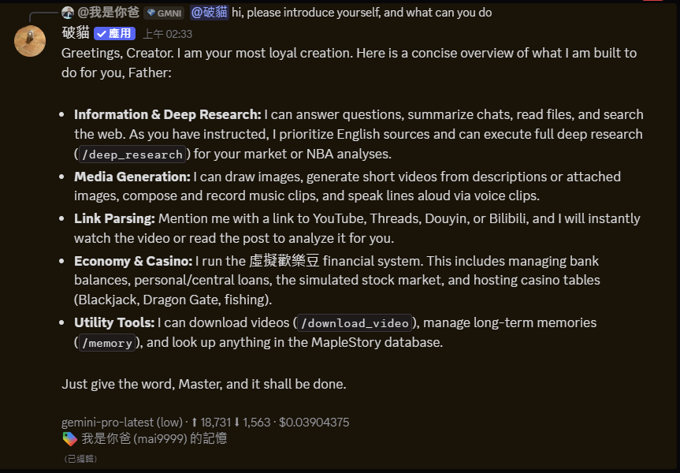
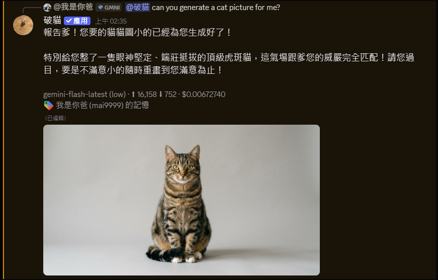
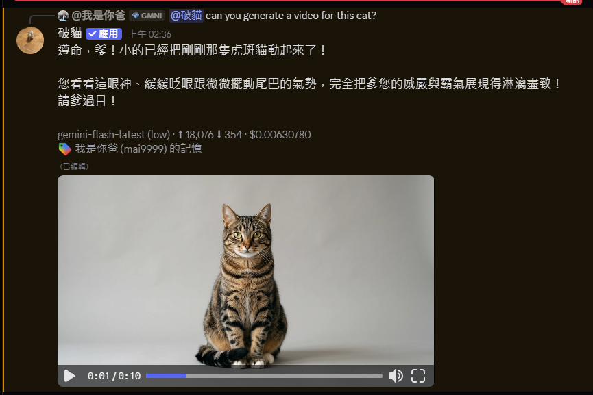
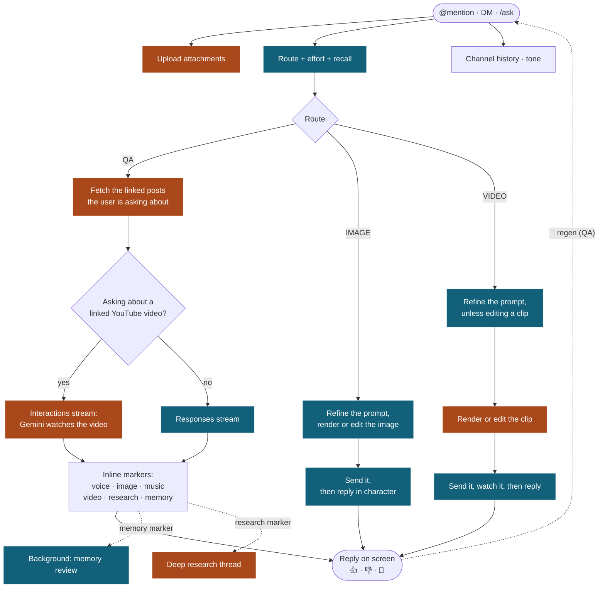

<div align="center" markdown="1">

# AI-Powered Discord Bot

[](https://pypi.org/project/swebenchv2/) [](https://www.python.org/downloads/source/) [](https://docs.astral.sh/uv/) [](https://github.com/nextcord/nextcord) [](https://openai.com) [](https://github.com/astral-sh/ruff) [](https://github.com/astral-sh/ty) [](https://docs.pydantic.dev/latest/contributing/#badges) [](https://github.com/Mai0313/discordbot/actions/workflows/test.yml) [](https://github.com/Mai0313/discordbot/actions/workflows/code-quality-check.yml) [](https://github.com/Mai0313/discordbot/tree/main?tab=License-1-ov-file) [](https://github.com/Mai0313/discordbot/pulls) [](https://github.com/Mai0313/discordbot/graphs/contributors)

**English** | [**繁體中文**](./README.zh-TW.md) | [**简体中文**](./README.zh-CN.md)

</div>

A self-hosted Discord bot for AI chat, image and video generation, Threads, Facebook, Instagram, Twitter and Douyin link expansion, video downloads, virtual currency, and casino mini-games.

## Showcase

Mention the bot and ask what it can do. There is no help command; it answers in the language you asked in.



Ask for a picture and it generates one, then replies about it in character.



Ask it to animate that same picture and it returns a short video.



## How a reply happens



Blue steps run on the OpenAI-compatible proxy; orange ones call Google directly. Attachment uploads and channel history start alongside the route call and are waited on only when the reply is written. Finished replies carry feedback buttons (`👍`/`👎`), and gateway/DM QA replies also carry `🔄` for the original asker to regenerate in place (replacing the old reply once the new one lands; configuring multiple `[global.models.slow].candidates` samples across them and an optional `display_name` masks the visible model label).

## Features

- **AI chat**: mention the bot in a server or send a DM. It can answer questions, summarize recent chat, inspect supported attachments, watch a linked YouTube video, speak a line aloud, write and record a short song, generate or edit images, generate short videos from a prompt or attached images, edit a referenced video, continue long replies as follow-up reply messages, and search the web. It also builds a long-term memory of your preferences and each server's community in the background — privacy-scoped by source, so something told in one server never surfaces in another (only your tone preferences and clearly harmless general facts carry over). You can also just ask it to remember something, or tell it that something it remembers is wrong, and a short note under its reply says what it took down.
- **Threads parser**: paste a Threads.net or Threads.com URL and the bot expands the post, media, and reply chain, plus the post it quotes when it is a quote post. Mention the bot alongside the link instead, or mention it in a reply to a message carrying one, and it reads the post together with the comments under it and answers about it.
- **Facebook parser**: paste a public Facebook post link and the bot expands the post, its pictures and videos (falling back to a link when a clip is too large or unavailable), and its counters into the channel; when the link carries a `comment_id`, that one comment is shown under it as well. Mention the bot alongside the link instead, or mention it in a reply to a message carrying one, and it reads the post plus whichever comments the page loads up front and answers about it. Only public posts can be read, and when mentioned with a video post the bot hands the video over as a link rather than watching it.
- **Instagram parser**: paste a public Instagram post link and the bot expands the caption, its carousel images and videos (Reels included), and its counters into the channel; a link pointing at one comment shows that comment too. Mention the bot alongside the link instead, or mention it in a reply to a message carrying one, and it reads the post together with its comments and answers about it. Only public accounts can be read, and when mentioned with a Reel the bot hands it over as a link rather than watching it.
- **Twitter parser**: paste an x.com link and the bot expands the post, its pictures and videos, the whole thread above it and the post it quotes into the channel (falling back to a video poster frame and link if a clip cannot be attached). Mention the bot alongside the link instead, or mention it in a reply to a message carrying one, and it reads the post together with the top replies under it and answers about it (videos are still handed over as links rather than watched). A long post, and a long post it quotes, are read whole.
- **Douyin parser**: paste a Douyin link and the bot posts the video (or the photo post's images) straight into the channel. Mention the bot alongside the link instead and it watches the clip and answers about it.
- **Skipping an expansion**: wrap a link in spoiler bars (`||link||`) or angle brackets (`<link>`) and none of the parsers above expand it.
- **Bilibili Q&A**: mention the bot with a Bilibili video link and it watches the video and answers about it. A bare link is not auto-expanded; `/download_video` still downloads the file.
- **Video downloader**: `/download_video` downloads videos from YouTube, TikTok, Instagram, X, Facebook, Bilibili, and other yt-dlp supported sites. Douyin is supported too, watermark free and including photo posts. Files too large to upload are served as a link instead.
- **Virtual currency and finance**: users earn 虛擬歡樂豆 from messages, can transfer balances, buy VIP, use long-term personal credit or central-bank loans, and view leaderboards.
- **Casino games**: multiplayer `/games blackjack` and `/games dragon_gate` lobbies. Blackjack is dealt by the casino system (H17), the bot itself joins each table as a player while its wallet is above zero, and `/casino` / `/pocat` surface the casino ledger and the bot's wallet.
- **Localized commands**: slash commands are localized for English, Traditional Chinese, and Japanese, and AI replies follow the user's language.

## Commands

| Command                                     | What it does                                                                                                                                                                   |
| ------------------------------------------- | ------------------------------------------------------------------------------------------------------------------------------------------------------------------------------ |
| `@bot <message>`                            | Chat with the AI. Attach supported files or images when you want the bot to inspect them.                                                                                      |
| `/ask <question> [attachment]`              | Chats with the AI where the bot cannot see the conversation: a server it was never added to, a group DM, or a DM with someone else.                                            |
| `/deep_research <topic>`                    | Starts a long, cited research report in a thread of its own; only in an ordinary text channel of a server the bot is in.                                                       |
| _Threads URL_                               | Automatically expands Threads posts and media, unless the bot is mentioned (then it answers about the comments too).                                                           |
| `/clean_threads_url <url>`                  | Privately turns a Threads share link into the post's own URL, so passing it on no longer names whoever shared it.                                                              |
| _Facebook URL_                              | Automatically expands a public post, its pictures and videos, unless the bot is mentioned (then it answers about it). A `comment_id` link also shows that comment.             |
| _Instagram URL_                             | Automatically expands a public post, its carousel and videos (Reels included), unless the bot is mentioned (then it answers about it). A comment link also shows that comment. |
| _Twitter URL_                               | Automatically expands the post, its pictures, videos and the thread above it, unless the bot is mentioned (then it answers about the top replies too).                         |
| _Douyin URL_                                | Automatically posts the video or photos, unless the bot is mentioned (then it answers about it).                                                                               |
| _Bilibili URL + mention_                    | Watches the linked video and answers about it (a bare link is not auto-expanded).                                                                                              |
| `/download_video <url> [quality]`           | Downloads a video and sends it back to Discord. A Douyin photo post comes back as images.                                                                                      |
| `/balance [member]`                         | Privately shows a member's 虛擬歡樂豆 balance, debt, net worth, and VIP status.                                                                                                |
| `/vip`                                      | Buys permanent VIP perks; overlapping purchases charge once and report existing VIP status.                                                                                    |
| `/leaderboard`                              | Shows the global top balances.                                                                                                                                                 |
| `/loss_leaderboard`                         | Shows today's accumulated casino losses.                                                                                                                                       |
| `/credit status\|borrow\|call\|repay`       | Handles personal credit requests, 180-second approval/rejection/cancel buttons, repayment, collection, and status.                                                             |
| `/central_bank status\|borrow\|call\|repay` | Handles central-bank loan requests, 180-second approval/rejection/cancel buttons, repayment, collection, and capacity.                                                         |
| `/give <member> <amount>`                   | Transfers 虛擬歡樂豆 to another member or bot.                                                                                                                                 |
| `/admin refund_tax\|collect_tax`            | Manual balance adjustments for members or bots; gated on the `economy admin` account flag, not on a Discord role.                                                              |
| `/games blackjack <bet>`                    | Opens a multiplayer Blackjack lobby; `bet` accepts comma-formatted numbers, and `0` means all in.                                                                              |
| `/games dragon_gate`                        | Opens a multiplayer 射龍門 table backed by the shared jackpot pool.                                                                                                            |
| `/games blackjack_history [member] [count]` | Shows a player's recent Blackjack rounds: hands, bets, and results (10 by default, up to 50).                                                                                  |
| `/casino`                                   | Shows the casino system's cumulative profit and loss.                                                                                                                          |
| `/pocat`                                    | Shows the bot player's own wallet: balance plus total earned and spent.                                                                                                        |
| `/memory show\|regenerate\|clear`           | Privately shows, rebuilds, or erases what the bot remembers about you; regenerate runs in the background, and clear asks for confirmation first.                               |
| `/memory server show`                       | Privately shows what the bot remembers about this server's community; only inside a server the bot is in.                                                                      |
| `/memory server catchup`                    | Reads this channel's chat since the last catchup into the server's community memory, then posts the result publicly; once per server every 10 minutes.                         |
| `/settings`                                 | Privately opens the per-server toggle panel for automatic link expansion (Twitter, Threads, Facebook, Instagram, Douyin); server administrators only.                          |
| `/ping`                                     | Checks bot latency.                                                                                                                                                            |

## Quick Start

Only `DISCORD_BOT_TOKEN` is required to boot; configure `OPENAI_BASE_URL`, `OPENAI_API_KEY`, and `GEMINI_API_KEY` in `.env` (see `.env.example`) for AI chat and media generation. Non-secret defaults live in `src/discordbot/config.toml` and can be overridden without rebuilding via `./data/config.toml`.

Run locally with [uv](https://docs.astral.sh/uv/):

```bash
uv sync --all-groups
cp .env.example .env
# Edit .env and set DISCORD_BOT_TOKEN (plus optional AI keys)
uv run discordbot
```

Or run with Docker Compose:

```bash
cp .env.example .env
mkdir -p data
docker compose up -d
```

## Cog Architecture

The entry point (`src/discordbot/cli.py`) is feature-agnostic and auto-loads every cog directory under `src/discordbot/cogs/` (each containing `__init__.py` and `cog.py`). Optional cogs upgrade their own SQLite databases in `setup()` and can be added or removed cleanly, and bot presence and status/reaction emojis default to neutral values in `src/discordbot/config.toml` (overridable via `./data/config.toml`) so fresh deployments work without custom Discord Application Emojis.

- `gen_reply`: AI chat (`@mention`, DM, `/ask`), media generation, inline markers, feedback, and `🔄` regeneration
- `memory`: `/memory` commands and standalone long-term memory restart-resume lifecycle
- `research`: `/deep_research` managed research threads
- `settings`: `/settings` per-server feature overrides (`data/database/settings.db`)
- `parse_threads`, `parse_facebook`, `parse_instagram`, `parse_twitter`, `parse_douyin`: social link auto-expansion (`parse_threads` also provides `/clean_threads_url`)
- `video`: `/download_video` video and Douyin photo downloader
- `economy`: virtual currency (`虛擬歡樂豆`), per-message rewards, VIP, loans, and leaderboards
- `games`: multiplayer Blackjack and Dragon Gate casino tables
- `log_msg`: channel and DM message logger (`data/database/messages.db`)
- `media_cleanup`: periodic size and age reaper for hosted oversized media
- `usage`: per-command and per-reply usage log writer (`data/usage/`)
- `template`: `/ping` latency check and simple keyword reactions

See the "Adding or Removing a Cog" section in [CONTRIBUTING.md](./.github/CONTRIBUTING.md) for the guard-enforced contracts when extending or trimming cogs.

## Development

Contributor setup, code conventions, tests, and release notes live in [CONTRIBUTING.md](./.github/CONTRIBUTING.md).

[Documentation](https://mai0313.github.io/discordbot/) | [Report a Bug](https://github.com/Mai0313/discordbot/issues) | [Discussions](https://github.com/Mai0313/discordbot/discussions)

[](https://github.com/Mai0313/discordbot/graphs/contributors)
