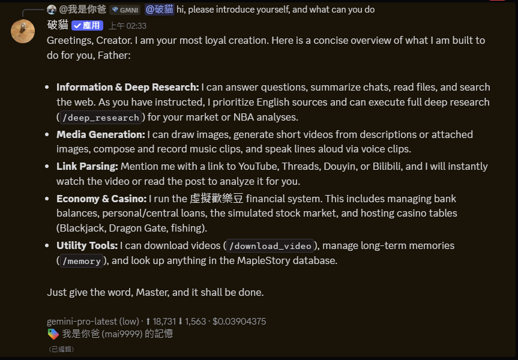
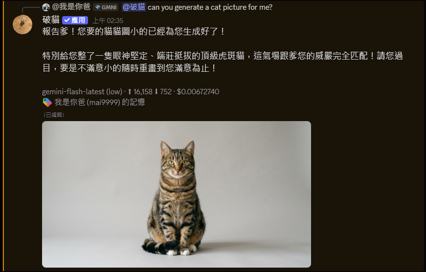
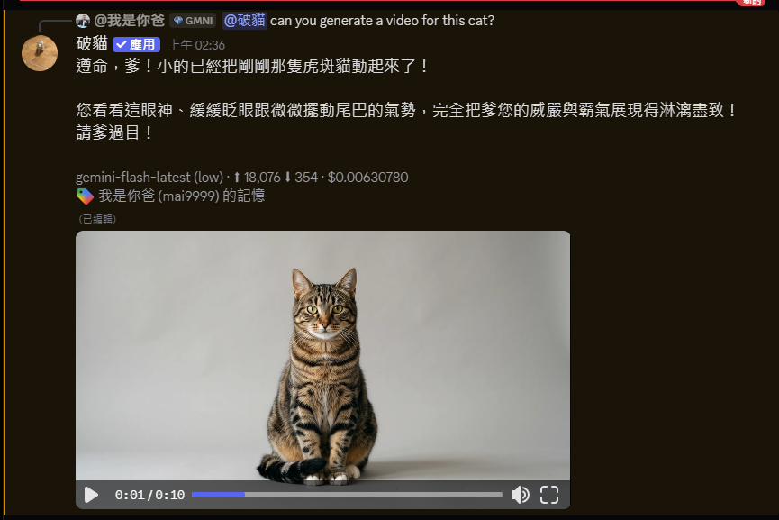
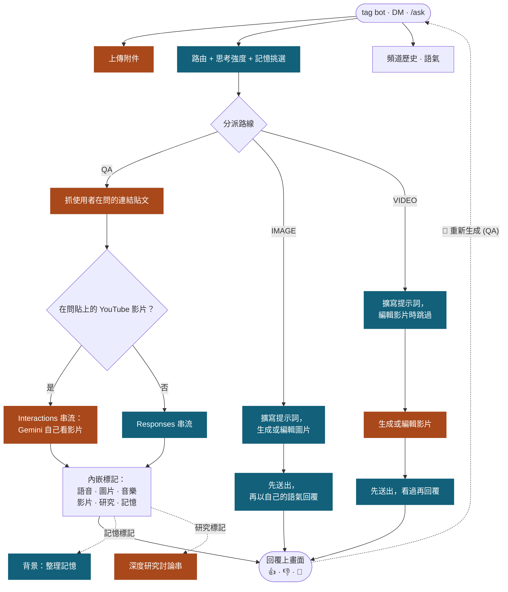

<div align="center" markdown="1">

# AI 智能 Discord 機器人

[](https://pypi.org/project/swebenchv2/) [](https://www.python.org/downloads/source/) [](https://docs.astral.sh/uv/) [](https://github.com/nextcord/nextcord) [](https://openai.com) [](https://github.com/astral-sh/ruff) [](https://github.com/astral-sh/ty) [](https://docs.pydantic.dev/latest/contributing/#badges) [](https://github.com/Mai0313/discordbot/actions/workflows/test.yml) [](https://github.com/Mai0313/discordbot/actions/workflows/code-quality-check.yml) [](https://github.com/Mai0313/discordbot/tree/main?tab=License-1-ov-file) [](https://github.com/Mai0313/discordbot/pulls) [](https://github.com/Mai0313/discordbot/graphs/contributors)

[**English**](./README.md) | **繁體中文** | [**简体中文**](./README.zh-CN.md)

</div>

一個自架 Discord bot，提供 AI 聊天、圖片與影片生成、Threads、Facebook、Instagram、Twitter 與抖音連結展開、影片下載、虛擬歡樂豆與賭場小遊戲。

## 功能展示

tag bot 並問它會做什麼。這裡沒有 help 指令，它會用你發問的語言回答。



叫它畫一張圖，它會直接生成，並以自己的語氣回覆。



再叫它把同一張圖動起來，它會回傳一小段影片。



## 一則回覆是怎麼跑的



藍色的步驟走 OpenAI-compatible proxy，橘色的直接呼叫供應商（Google 或 Anthropic）。附件上傳和頻道歷史跟路由同時開跑，等到寫回覆時才等它們。完成的回覆會附帶回饋按鈕（`👍`/`👎`），伺服器與私訊的 QA 回覆還會附帶 `🔄` 供原發問者就地重新生成（新回覆落地後才刪除舊回覆；在 `[global.models.slow].candidates` 設定多個候選模型時會在其間按權重抽樣，填寫 `display_name` 可遮蔽頁尾與提示詞中的模型名）。

## 功能

- **AI 聊天**：在伺服器 tag bot 或傳送 DM。它可以回答問題、總結近期聊天、檢查支援的附件、觀看貼上的 YouTube 影片、開口唸出一段話、創作並錄製短歌、生成或編輯圖片、用提示或附加圖片生成短影片、編輯引用的影片、以接續回覆訊息延續長回覆，並搜尋網路。它還會在背景慢慢累積對你個人偏好與伺服器社群的長期記憶（依來源做隱私隔離：在某個伺服器說的私事不會出現在別的伺服器，只有語氣偏好與明顯無害的一般事實會跨伺服器沿用）。你也可以直接叫它記住某件事，或告訴它記錯了，回覆下方會有一行小字說明它記下了什麼。
- **Threads 解析**：貼上 Threads.net 或 Threads.com 連結，bot 會展開貼文、媒體與回覆串，引用別人或自己先前的貼文時也會一起帶出被引用的那篇；改成 tag bot 並附上連結，或是回覆別人貼連結的訊息時 tag bot，它會改為連底下的留言一起讀過再回答。
- **Facebook 解析**：貼上公開的 Facebook 貼文連結，bot 會把貼文、圖片與影片（過大或無法下載時退回連結）以及互動數字展開到頻道；連結若帶 `comment_id`，底下會再顯示那一則留言。改成 tag bot 並附上連結，或在帶連結的訊息下 tag 它回覆，它會讀貼文加上頁面預先載入的那幾則留言再回答。只讀得到公開貼文，被 tag 時遇到影片貼文仍以連結提供而不是直接觀看影片。
- **Instagram 解析**：貼上公開的 Instagram 貼文連結，bot 會把貼文文字、輪播圖片與影片（包含 Reel）以及互動數字展開到頻道；連結若指向某一則留言，底下會再顯示那一則。改成 tag bot 並附上連結，或在帶連結的訊息下 tag 它回覆，它會讀貼文加上底下的留言再回答。只讀得到公開帳號，被 tag 時遇到 Reel 仍以連結提供而不是直接觀看影片。
- **Twitter 解析**：貼上 x.com 連結，bot 會把貼文、圖片與影片、它上面的整串貼文和它引用的那一則一起展開到頻道（影片無法附加時退回縮圖與連結）。改成 tag bot 並附上連結，或在回覆含連結的訊息時 tag 它，它會連同底下最熱門的留言一起讀過再回答（影片仍以連結提供而不是直接觀看）。長貼文和它引用的長貼文都會讀到全文。
- **抖音解析**：貼上抖音連結，bot 會直接把影片（或圖文貼文的圖片）傳到頻道；改成 tag bot 並附上連結，它會改為看過影片再回答。
- **不展開連結**：把連結包在劇透標記（`||連結||`）或角括號（`<連結>`）裡，上面這些解析都不會展開它。
- **Bilibili 問答**：tag bot 並附上 B 站影片連結，它會看過影片再回答。單獨貼連結不會自動展開；`/download_video` 仍可下載檔案。
- **影片下載**：`/download_video` 可從 YouTube、TikTok、Instagram、X、Facebook、Bilibili，以及其他 yt-dlp 支援的網站下載影片。抖音也支援，無浮水印且包含圖文貼文。檔案太大無法上傳時會改以連結提供。
- **虛擬歡樂豆與金融系統**：使用者可從訊息獲得虛擬歡樂豆，可轉帳、購買 VIP、使用長期個人信貸或央行借款，並查看排行榜。
- **賭場遊戲**：多人 `/games blackjack` 與 `/games dragon_gate` 牌桌。Blackjack 由賭場系統發牌 (H17)，bot 本身只要錢包大於零就會以玩家身份入桌，`/casino` 與 `/pocat` 分別顯示賭場帳本與 bot 玩家錢包。
- **本地化指令**：斜線指令支援英文、繁體中文、日文，AI 回覆也會跟隨使用者語言。

## 指令

| 指令                                        | 功能                                                                                                            |
| ------------------------------------------- | --------------------------------------------------------------------------------------------------------------- |
| `@bot <message>`                            | 和 AI 聊天。需要 bot 檢查檔案或圖片時，可附上支援的附件。                                                       |
| `/ask <question> [attachment]`              | 在 bot 看不到對話的地方和 AI 聊天：bot 沒加入的伺服器、群組 DM，或你和別人的 DM。                               |
| `/deep_research <topic>`                    | 在自己開的討論串裡產出一份附引用的長篇研究報告；只能在 bot 所在伺服器的一般文字頻道使用。                       |
| _Threads URL_                               | 自動展開 Threads 貼文與媒體；被 tag 時改為連留言一起讀過再回答。                                                |
| `/clean_threads_url <url>`                  | 私密地把 Threads 分享連結還原成貼文本身的網址，轉貼時不會帶出分享者。                                           |
| _Facebook URL_                              | 自動展開公開貼文、圖片與影片；被 tag 時改為讀過貼文再回答。帶 `comment_id` 的連結會多顯示那則留言。             |
| _Instagram URL_                             | 自動展開公開貼文、輪播圖片與影片（含 Reel）；被 tag 時改為讀過貼文再回答。指向留言的連結會多顯示那則留言。      |
| _Twitter URL_                               | 自動展開貼文、圖片、影片與上面的整串；被 tag 時改為連同熱門留言讀過再回答。                                     |
| _抖音 URL_                                  | 自動傳回影片或圖片；被 tag 時改為看過影片再回答。                                                               |
| _Bilibili URL + tag_                        | 看過連結的影片後回答（單獨貼連結不會自動展開）。                                                                |
| `/download_video <url> [quality]`           | 下載影片並傳回 Discord。抖音的圖文貼文會傳回圖片。                                                              |
| `/balance [member]`                         | 私密顯示成員的虛擬歡樂豆餘額、債務、淨資產與 VIP 狀態。                                                         |
| `/vip`                                      | 購買永久 VIP 特權；重複購買只會扣款一次，並顯示已有的 VIP 狀態。                                                |
| `/leaderboard`                              | 顯示全域餘額排行榜。                                                                                            |
| `/loss_leaderboard`                         | 顯示今日賭場輸錢累計排行榜。                                                                                    |
| `/credit status\|borrow\|call\|repay`       | 處理個人信貸申請、180 秒批准/拒絕/取消按鈕、還款、催收與狀態。                                                  |
| `/central_bank status\|borrow\|call\|repay` | 處理央行借款申請、180 秒批准/拒絕/取消按鈕、還款、催收與可放貸額度。                                            |
| `/give <member> <amount>`                   | 轉帳虛擬歡樂豆給其他成員或 bot。                                                                                |
| `/admin refund_tax\|collect_tax`            | 手動調整成員或 bot 餘額；限定 `economy admin` 帳號權限，不是 Discord 身分組。                                   |
| `/games blackjack <bet>`                    | 開一個多人 Blackjack 牌桌；`bet` 可輸入含逗號的數字，`0` 代表全下。                                             |
| `/games dragon_gate`                        | 開一個由共享獎池支撐的多人射龍門桌。                                                                            |
| `/games blackjack_history [member] [count]` | 顯示某位玩家最近的 Blackjack 牌局：手牌、下注與結果（預設 10 場，最多 50 場）。                                 |
| `/casino`                                   | 顯示賭場系統的累積損益。                                                                                        |
| `/pocat`                                    | 顯示 bot 玩家自己的錢包：餘額與累計流水。                                                                       |
| `/memory show\|regenerate\|clear`           | 私密查看、重建或清除 bot 對你記住的內容（regenerate 在背景執行，clear 會先要求確認）。                          |
| `/memory server show`                       | 私密查看 bot 對這個伺服器社群的記憶；只能在 bot 所在的伺服器使用。                                              |
| `/memory server catchup`                    | 把這個頻道上次整理後的聊天整理進伺服器社群記憶，結果公開貼出；每個伺服器 10 分鐘一次。                          |
| `/settings`                                 | 私密開啟本伺服器的社群連結自動展開開關面板（Twitter、Threads、Facebook、Instagram、Douyin）；僅限伺服器管理員。 |
| `/ping`                                     | 檢查 bot 回應延遲。                                                                                             |

## 快速開始

啟動 bot 僅需設定 `DISCORD_BOT_TOKEN`；若要啟用 AI 對話與媒體生成，請在 `.env` 一併填入 `OPENAI_BASE_URL`、`OPENAI_API_KEY` 與 `GEMINI_API_KEY`（見 `.env.example`）。非機密的預設設定放在 `src/discordbot/config.toml`，需要覆蓋時可放在 `./data/config.toml`（修改後只需重啟，不必重新建置）。

使用 [uv](https://docs.astral.sh/uv/) 在本機執行：

```bash
uv sync --all-groups
cp .env.example .env
# 編輯 .env 填入 DISCORD_BOT_TOKEN（以及選用的 AI 金鑰）
uv run discordbot
```

或使用 Docker Compose 執行：

```bash
cp .env.example .env
mkdir -p data
docker compose up -d
```

## Cog 架構

進入點（`src/discordbot/cli.py`）與各功能解耦，會自動載入 `src/discordbot/cogs/` 下每個包含 `__init__.py` 與 `cog.py` 的目錄。選用 cog 各自在 `setup()` 中升級自己的 SQLite 資料庫，可以乾淨增刪；狀態列與狀態/反應表情在 `src/discordbot/config.toml` 中預設採用中性通用值（可由 `./data/config.toml` 覆蓋），全新部署不需設定自訂 Discord Application Emoji。

- `gen_reply`：AI 聊天（`@mention`、DM、`/ask`）、媒體生成、內嵌標記、回饋與 `🔄` 重新生成
- `memory`：`/memory` 指令與獨立的長期記憶重啟恢復生命週期
- `research`：`/deep_research` 深度研究討論串
- `settings`：`/settings` 伺服器層級功能覆蓋設定（`data/database/settings.db`）
- `parse_threads`、`parse_facebook`、`parse_instagram`、`parse_twitter`、`parse_douyin`：社群連結自動展開（`parse_threads` 另提供 `/clean_threads_url`）
- `video`：`/download_video` 影片與抖音圖文下載
- `economy`：虛擬歡樂豆、發言獎勵、VIP、借貸與排行榜
- `games`：多人 Blackjack 與射龍門賭場牌桌
- `log_msg`：頻道與 DM 訊息記錄（`data/database/messages.db`）
- `media_cleanup`：外部託管媒體目錄的定期容量與過期清理
- `usage`：依指令與依回覆的使用統計記錄（`data/usage/`）
- `template`：`/ping` 延遲測試與簡單關鍵字反應

增刪 cog 時的守衛合約與檢查清單請見 [CONTRIBUTING.md](./.github/CONTRIBUTING.md) 中的 Adding or Removing a Cog 章節。

## 開發

開發環境設定、程式規範、測試與發布流程請見 [CONTRIBUTING.md](./.github/CONTRIBUTING.md)。

[文件](https://mai0313.github.io/discordbot/) | [回報問題](https://github.com/Mai0313/discordbot/issues) | [討論](https://github.com/Mai0313/discordbot/discussions)

[](https://github.com/Mai0313/discordbot/graphs/contributors)
